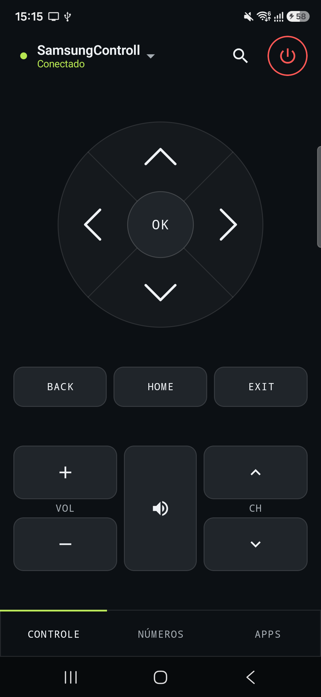
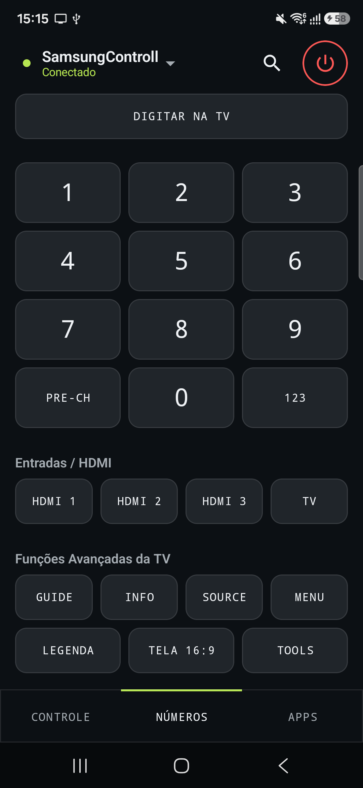
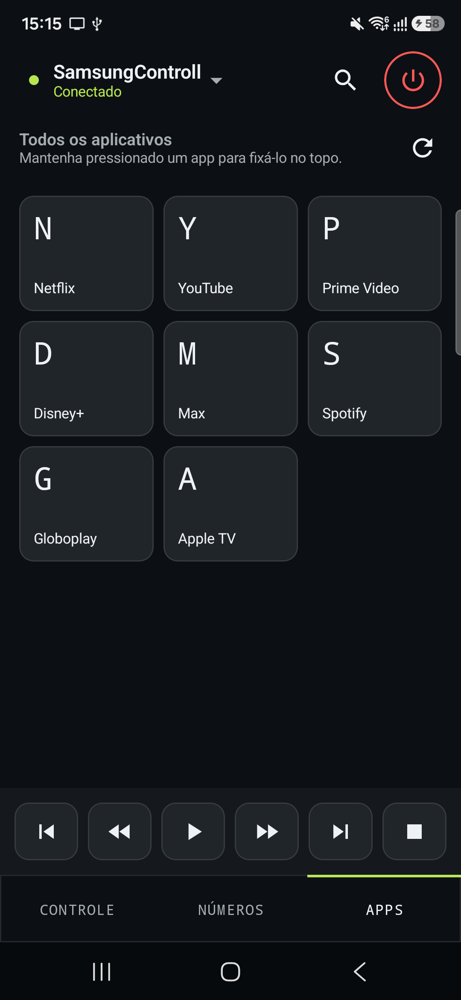

# SamsungControll

SamsungControll é um controle remoto Android local-first para TVs Samsung. O app descobre TVs na rede local, conecta via WebSocket e envia comandos de controle remoto sem depender de Samsung Account ou integração com SmartThings.

## Objetivo

O projeto busca ser um controle simples, direto e privado para uso na rede local:

- Sem login Samsung.
- Sem cloud própria.
- Sem analytics.
- Sem automações frágeis dependentes do estado interno de apps de streaming.
- Com persistência segura de tokens e pareamento local com a TV.
- Respeitando o padrão **SOLID** de arquitetura de software e injeção de dependências.

## Funcionalidades

- **Quatro páginas com abas na parte de baixo** (ao alcance do polegar), no sistema visual "Graphite & Signal" (ver [design.md](design.md)):
  - **Controle**: D-Pad de quatro setores com OK no centro, `BACK`/`HOME`/`EXIT`, balancins de volume e canal e `MUTE`. Direções, volume e canal repetem enquanto pressionados.
  - **Toque**: touchpad de gestos como o do Google TV: deslize para navegar, toque para OK, toque duplo para Início e toque longo para Voltar.
  - **Números**: teclado 0-9 (`Pre-Ch`, `123`), entradas (`HDMI 1-3`, `TV`), funções avançadas recolhidas em "Mais teclas" (`GUIDE`, `INFO`, `SOURCE`, `MENU`, `LEGENDA`, `TELA 16:9`, `TOOLS`) e o botão **Digitar na TV**.
  - **Apps**: grade com os apps instalados na TV (ou os 8 atalhos padrão enquanto a lista não chega), toque longo abre ações (fixar no topo, "Ligar a TV e abrir", atalho na tela inicial), e barra de reprodução fixa (anterior, retroceder, play/pause, avançar, próximo, parar).
- **Cabeçalho de uma linha**: nome e estado da TV (toque para trocar de TV, apelidar, ver detalhes, reconectar ou abrir configurações), busca e power.
- **Teclado e Lista de Apps**:
  - Botão **Digitar na TV** (e abertura automática quando a TV foca um campo de texto) envia texto via `SendInputString`.
  - A aba Apps lista os aplicativos instalados na TV (`ed.installedApp.get`).
- **Configurações** (menu ⋮): liga/desliga vibração, escolhe se os botões de volume do celular controlam a TV e define um tempo de inatividade (15/30/60 min) para desconectar sozinho e liberar a notificação.
- **Várias TVs**: toda TV conectada fica salva no menu ⋮, onde dá para trocar de TV com um toque ou esquecê-la (apaga token e certificado). O Tile e a reconexão automática seguem a TV ativa.
- **Idiomas**: interface em inglês (padrão) e português, via `strings.xml` (`values/` e `values-pt/`); o app segue o idioma do sistema.
- **Segurar para repetir**: setas do D-Pad, volume e canal repetem enquanto o dedo permanece pressionado.
- **Informações Detalhadas da TV (REST API)**:
  - Consulta automática no endpoint REST local `http://IP:8001/api/v2/`.
  - Exibe no menu: Modelo da TV, Sistema Operacional (Tizen), Firmware, Tipo de Conexão (Wi-Fi/Ethernet), IP e MAC.
- **Busca & Apelidos de TV**:
  - Busca de TVs Samsung na rede local via SSDP/UPnP com filtragem estrita.
  - Entrada manual de IP com botão dedicado.
  - Apelidos personalizados criptografados no dispositivo (*TV da Sala*, *TV do Quarto*).
- **Wake-on-LAN & Reconexão**:
  - Envio de magic packets para acordar a TV desligada antes de reconectar.
  - Reconexão direta ao voltar do segundo plano (`ON_RESUME`), caindo para Wake-on-LAN apenas se a conexão direta falhar.
  - Reconexão automática quando a rede volta a ficar disponível (troca/retorno de Wi-Fi) via `ConnectivityManager`.
- **Segundo plano (opcional, desligado por padrão)**:
  - Em Configurações, "Manter conectado em segundo plano" inicia o `TvConnectionService` (notificação com ação **Desconectar**) e uma sessão de mídia remota: os botões de volume do celular controlam a TV mesmo com a tela apagada. A permissão de notificação só é pedida ao ligar essa opção.
- **Volume pelos Botões Físicos**:
  - Com o app aberto e conectado, os botões de volume do celular controlam a TV (`KEY_VOLUP`/`KEY_VOLDOWN`); desconectado, o volume do próprio aparelho volta ao normal.
- **Quick Settings Tile**:
  - Tile "TV Power" para ligar/desligar a TV direto das Configurações Rápidas, sem abrir o app (KEY_POWER quando alcançável, Wake-on-LAN quando desligada).
  - Reflete o estado real da TV (ligada/standby) sondando o endpoint REST local, usando `PowerState` quando a firmware o expõe.
- **Fora do app**:
  - **Widget** na tela inicial com power, mudo e volume.
  - **Atalhos** no ícone do app (power e mudo) e **atalhos fixos** criados por toque longo: "Ligar a TV e abrir <app>" ou "Ligar a TV e trocar para HDMI N" (liga por Wake-on-LAN, espera a TV acordar e executa).
- **UI Premium & Haptics**:
  - Feedback tátil (vibração hática) configurável via `HapticsManager`.
  - Animação curta de compressão ao pressionar (`pressScale`), sem quique.

## Capturas de Tela

| Controle | Números | Apps |
|:---:|:---:|:---:|
|  |  |  |

## Stack

- Kotlin.
- Android SDK 37.
- Jetpack Compose com Material 3.
- Injeção de Dependências com **Koin 3.5.6**.
- AndroidX Lifecycle ViewModel.
- OkHttp para HTTP/WebSocket.
- Gradle Kotlin DSL.

## Arquitetura & SOLID

Principais classes e abstrações:

- `SamsungControlApplication`: ponto de inicialização da Application e container do Koin.
- `di/AppModule`: módulo Koin para injeção desacoplada de dependências.
- `MainActivity`: host do Compose, injeção do `RemoteViewModel` e roteamento dos botões físicos de volume para a TV.
- `RemoteControlScreen`, `RemoteHeader`, `RemotePages`: tela principal, cabeçalho com o menu da TV e as quatro páginas.
- `RemoteViewModel`: estado de UI, descoberta, conexão, apelidos e ações do controle.
- `TvConnectionException`: hierarquia selada de exceções (`NetworkUnreachable`, `PermissionDenied`, `DeviceNotFound`, `CertificateMismatch`).
- `SamsungDeviceInfoResolver`: leitor REST da API local `/api/v2/` para extração de modelo, OS e firmware.
- `HapticsManager`: interface desacoplada para feedback tátil (`AndroidHapticsManager` e `NoOpHapticsManager`).
- `PressAnimation`: modificador reutilizável `Modifier.pressScale` (tween curto, sem quique).
- `TvController` & `SamsungTvController`: contrato e implementação do controle remoto WebSocket.
- `TvConnectionService`: foreground service opcional que mantém a conexão e encaminha o volume com a tela apagada.
- `QuickTvActions`, `QuickActionActivity`, `QuickActionReceiver`, `RemoteWidgetProvider`, `ShortcutPinner`: ações sem UI (widget, atalhos, cenas) com conexão curta à TV.
- `TvPowerTileService`: Quick Settings Tile que liga/desliga a TV e reflete seu estado atual.
- `DiscoveryService` & `TvDiscovery`: contrato e implementação de descoberta SSDP/UPnP.
- `WakeOnLanSender`: envio de magic packets UDP.
- `SecureTvPreferences`: persistência segura de IP, apelidos, tokens e certificados TOFU.

## Segurança

- Só permite conexão com IPs/hosts de rede local.
- Armazena tokens com Android Keystore.
- Associa tokens, apelidos e MACs por identidade SSDP e por IP.
- Pinagem TOFU do certificado SSL/TLS da TV.

## Requisitos

- Android Studio recente.
- JDK compatível com o Gradle configurado.
- Android SDK 37.1 instalado.
- Dispositivo Android conectado na mesma rede local da TV.

## Como Rodar e Testar

Via terminal:

```bash
./gradlew test
./gradlew lint
./gradlew assembleDebug
```

Para executar a suíte de testes de UI do Compose:

```bash
./gradlew connectedCheck
```

Para gerar o pacote de Release (APK / AAB otimizado):

```bash
./gradlew assembleRelease
```

## Licença

Distribuído sob a licença MIT. Veja [LICENSE](LICENSE).
